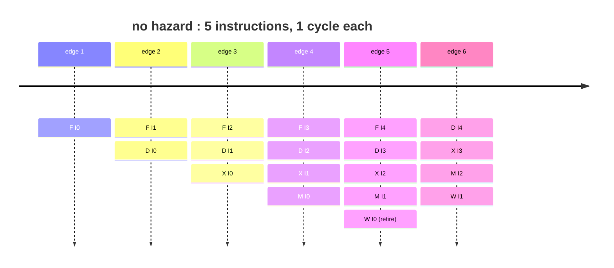
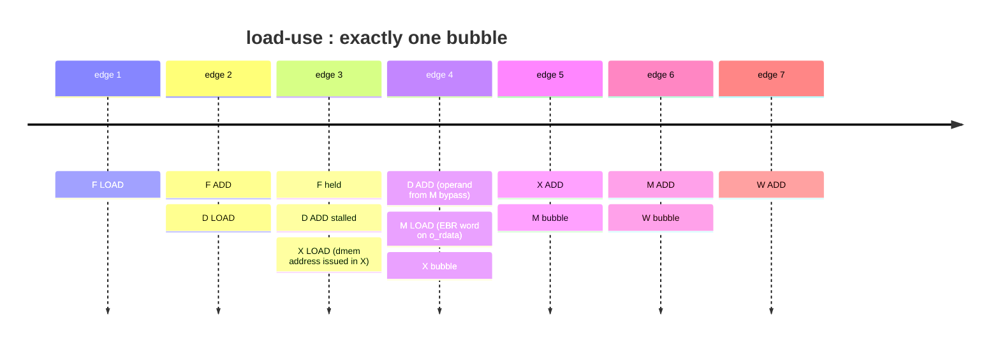
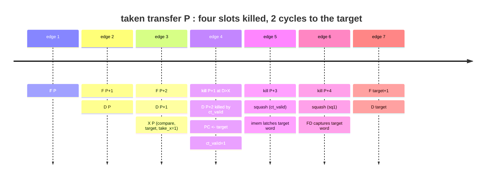
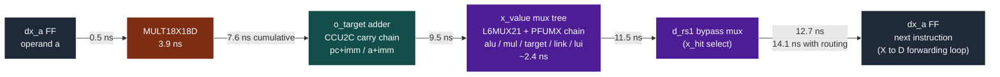

# risc18 core architecture and cycle timing

Generated from `src/risc18/core.py` at `main` `2362077` (M10 decode-in-F, M11
optional RAM register file). Every number here is measured on the Colorlight
5A-75B (`LFE5U-25F-6CABGA256`, speed grade 6) by
`tools/synth.py` → yosys 0.52 → nextpnr-ecp5 0.7-1 (post place-and-route);
fmax comes from the four-seed protocol (seeds 1/2/3/7), never from a yosys
estimate.

## 1. Datapath by pipeline stage

```mermaid
flowchart LR
    classDef reg fill:#1f2937,stroke:#f9fafb,color:#f9fafb
    classDef ebr fill:#4c1d95,stroke:#f9fafb,color:#f9fafb
    classDef comb fill:#134e4a,stroke:#f9fafb,color:#f9fafb
    classDef stage fill:#0f172a,stroke:#38bdf8,color:#e5e7eb

    PC["PC register<br/>18 bit"]:::reg
    IMEM["imem EBR<br/>1024 x 18<br/>addr to data = 1 edge<br/>t_co 5.6 ns"]:::ebr
    DEC["decoder (in F)<br/>19 fields / 54 bit<br/>combinational, 2 LUTs"]:::comb

    FD["FD register<br/>19 fields + valid + pc<br/>54 bit"]:::reg

    subgraph Dstage["D : read + bypass (no state changing work)"]
        RF_F["RegFile (flop)<br/>16 x 18, comb read<br/>2 x 16:1 mux = ~540 nodes"]:::comb
        RF_R["RegFileRam (opt-in)<br/>2 banks x 5 TRELLIS_DPR16X4<br/>registered read"]:::ebr
        BYP["bypass select<br/>x_hit &gt; m_hit &gt; w_hit &gt; wq_hit &gt; regfile"]:::comb
        HZ["load-use detect<br/>d_need &amp; dx_mem_read &amp; rd match"]:::comb
    end
    class Dstage stage

    DX[" DX register<br/>valid, pc, we, rd, a, rs2,<br/>alu_op, imm, mul, lui, link,<br/>halt, mem_r, mem_w, branch,<br/>cond, jump_reg"]:::reg

    subgraph Xstage["X : execute, resolve control"]
        ALU["ALU<br/>add/sub on carry chain<br/>logic on LUTs"]:::comb
        MUL["MULT18X18D<br/>3.9 ns measured"]:::comb
        CMP["branch compare<br/>on dx_a / dx_rs2"]:::comb
        TGT["BranchTarget adder<br/>pc+imm / a+imm (JALR)"]:::comb
        TX["take_x<br/>registered into ct_valid"]:::comb
        DMEM["dmem EBR<br/>1024 x 18, address = ALU result<br/>store data = dx_rs2"]:::ebr
    end
    class Xstage stage

    XM["XM register<br/>valid, pc, we, rd, value,<br/>mem_read"]:::reg

    subgraph Mstage["M : memory return, forward"]
        MV["m_value = mem_read ? dmem.o_rdata : xm_value"]:::comb
    end
    class Mstage stage

    MW["MW register<br/>retire pc / rd / value"]:::reg

    subgraph Wstage["W : writeback + retire"]
        WB["regfile write port<br/>(flop: same-cycle read-through<br/>RAM: w / wq bypass carry it)"]:::comb
        RET["retire ports<br/>o_retire_* / o_halt"]:::comb
    end
    class Wstage stage

    PC -->|"1 edge"| IMEM
    IMEM -->|"1 edge, 5.6 ns c2o"| DEC
    DEC -->|"fields"| FD
    FD --> RF_F
    FD --> RF_R
    FD --> BYP
    RF_F --> BYP
    RF_R -->|"address issued in F,<br/>data one edge later"| BYP
    BYP --> DX
    HZ -.->|"stall: hold Fetch + FD,<br/>bubble into X, 1 cycle"| FD
    DX --> ALU
    DX --> MUL
    DX --> CMP
    DX --> TGT
    ALU --> TX
    CMP --> TX
    TGT --> TX
    ALU --> DMEM
    DX -->|"store data"| DMEM
    ALU --> XM
    MUL --> XM
    TGT --> XM
    DMEM -->|"read data one edge later"| MV
    XM --> MV
    MV --> MW
    MW --> WB
    MW --> RET
    TX -->|"ct_valid: PC mux next edge,<br/>squash = ct_valid | sq1"| PC
    WB -->|"write -> X bypass<br/>(distance 1)"| BYP
    MV -->|"M bypass (distance 2)"| BYP
```



Data hazards and the mechanism that covers each (all verified by mutation in
`tests/test_ramrf.py` and `tests/test_core.py`):

| producer distance | stage when consumer is in D | mechanism | cost |
|---|---|---|---|
| 1 (X) | X | `x_value` → `d_rs1`/`d_rs2` | 0 |
| 2 (M) | M | `m_value` (ALU/MUL/link/LUI, or the load's EBR word) | 0 |
| 3 (W) | W | flop file: W writes through the combinational read; RAM file: `w_hit` | 0 |
| 4 (retired) | — | RAM file only: `wq_hit` (W-1 pipeline register) | 0 |
| load-use | load in X, consumer in D | one stall: hold Fetch + FD, bubble into X | 1 cycle |

## 2. Cycle timing

Counted in clock edges. `imem` is an EBR with a one-edge address-to-data
latency, decode runs on that registered word, so an instruction is decoded two
edges after its PC became the fetch address.

### Straight line



### Load followed immediately by a consumer



The stall repeats D for one cycle (`FD` held, bubble into X), so the consumer's
operands are sampled on the edge where the load's word is already on
`dmem.o_rdata` -- one bubble total, and no M to X forward is needed.

### Taken branch or jump (resolved in X)



Cost model, measured: taken transfers make CPI 1.37 → 1.60 on the store/load
loop and 1.42 → 1.84 on `CORE_TOP_PROGRAM` (M9a).

## 3. Critical path, flop register file (default)

CoreTop, 60 MHz constraint, seed 1: **1640 LUT4, 640 FF, 71.03 MHz**,
critical path 5.8 ns logic + 8.3 ns routing = **14.1 ns** (period 16.67 ns at
60 MHz; fmax sweep 71.03 / 75.59 / 72.14 / 73.61).



The loop is one cycle wide: an X-stage result is forwarded into D and captured
into the next instruction's `dx_a` on the same edge. Two earlier critical paths
(compare → redirect → PC mux → FD capture, and X result → forward select →
compare) were removed by M9a: the compare moved behind the X-stage operand
registers, and the redirect is applied from a registered `ct_valid`.

## 4. Critical path, RAM register file (`--ram-rf`)

CoreTop, 60 MHz constraint, seed 1: **1183 LUT4, 407 FF, 73.48 MHz**,
critical path 6.8 ns logic + 6.8 ns routing = **13.6 ns** (fmax sweep
73.48 / 75.27 / 68.24 / 73.44).


Two different walls in the two configurations, which is why the RAM file is not
the default: with flops the mux tree is hidden behind the write-through and the
ALU/multiply side dominates; with distributed RAM the 5.6 ns EBR
clock-to-out is exposed in front of the read address. FullTop (PLL + boot
sequencer) measures 73.67 MHz flop (`m9_full`) / 68.16 MHz RAM (`m11_full_ram`)
at seed 1, re-measured in stage 4 with the corrected PLL.

## 5. Reproduce

```
.venv/bin/python tools/synth.py --top risc18.tops:CoreTop --name m11_core_flop --freq 60 --seed 1
.venv/bin/python tools/synth.py --top risc18.tops:CoreTop --name m11_core_ram  --freq 60 --seed 1 --ram-rf
.venv/bin/python tools/synth.py --top risc18.tops:FullTop  --name m11_full_ram  --freq 25 --seed 1 --ram-rf
```

The four-seed sweep is the same command with `--seed 2|3|7` and a seed-suffixed
`--name`. Committed reports: `docs/metrics/m11_core_flop.md`,
`m11_core_ram.md`, `m11_full_ram.md`; the segment-level numbers above come from
the `Critical path report` blocks in the matching `build/synth/*/pnr_seed1.log`.

## 6. Cost breakdown: which cones spend LUT4, which spend delay

Two facts first, because they bound everything else. Cell-type counts come
straight out of the mapped netlist (`build/synth/<build>/top.json`):

| build | LUT4 cells | CCU2C | PFUMX | L6MUX21 | FF | DSP | DPR16X4 |
|---|---:|---:|---:|---:|---:|---:|---:|
| flop register file | 1514 | 63 | 347 | 129 | 640 | 1 | 0 |
| RAM register file | 997 | 63 | 235 | 70 | 407 | 1 | 10 |

A CCU2C occupies two LUT4 sites, so the flop build's 1640 sites are exactly
1514 + 2 x 63; PFUMX and L6MUX21 pack into LUT4 sites rather than adding to
them, but they are the mux trees and they are where the delay lives.

Per-cone attribution is **not** additive. ABC remaps globally, so a small edit
can remove logic and make area go up. The numbers below are single-variant
builds (`tools/ablations.sh`, CoreTop, seed 1, synthesis only, functionally
wrong on purpose) and are read as "the shape of this cone's cost", with the two
structural moves -- the register-file read muxes and the forwarding network --
being the only ones large enough to trust as arithmetic.

| variant | flop LUT4 | delta | flop fmax | RAM LUT4 | delta | RAM fmax |
|---|---:|---:|---:|---:|---:|---:|
| control | 1640 | -- | 71.03 | 1183 | -- | 73.48 |
| forwarding network removed | 1447 | -193 | 69.57 | 1001 | -182 | 72.07 |
| branch compare tied off | 1521 | -119 | 77.82 | 1084 | -99 | 72.12 |
| branch target adder removed | 1567 | -73 | 77.35 | 1218 | +35 | 67.94 |
| multiply forced to constant | 1738 | +98 | 79.63 | 1295 | +112 | 66.76 |
| register-file read muxes (`--ram-rf`) | 1183 | -457 | 73.48 | -- | -- | -- |

How to read the two odd rows:

* **multiply** is not an area cost, it is a remap. Deleting the DSP frees
  3.9 ns of the critical loop, so ABC re-maps the whole `x_value` cone for speed
  and area goes *up* while fmax gains 8.6 MHz (flop build). In the RAM build the
  same deletion *loses* 6.7 MHz: once the read muxes are gone the select tree,
  not the multiply, is what the loop is made of, and taking the DSP out only
  makes that tree bigger.
* **branch target adder** saves 73 LUT4 and 18 FF with flops (the adder goes and
  `ct_target` collapses into `dx_pc`) but the RAM build measures *+35* LUT4 --
  pure remap noise, which is exactly the reason not to quote single-variant
  deltas as budgets.

Delay, from the nextpnr critical-path segments:

| | flop build | RAM build |
|---|---|---|
| worst path | 14.1 ns (5.8 logic + 8.3 routing), 71.03 MHz | 13.6 ns (6.8 logic + 6.8 routing), 73.48 MHz |
| chain | `dx_a` FF 0.5 -> MULT18X18D 3.9 -> `o_target` CCU2C 1.9 -> `x_value` select tree, 4 L6MUX21/PFUMX levels, 2.0 -> `d_rs1` bypass 1.2 -> `dx_a` of the next instruction | imem EBR DOA clock-to-out 5.6 -> decode cone, 2 LUT levels, 2.0 -> regfile read address + stall mux 2.0 -> DPR16X4 addr-to-out 1.9 -> read-data FF |
| what it means | one 18-bit loop: multiply -> target -> result select -> forward -> operand register | fetch-side chain, no arithmetic in it |
| routing share | 59 % | 50 % |
| second-worst path | 8.3 ns, `i_rst` to FF reset pins | 7.3 ns, same |

The second-worst path in both builds is reset distribution, not datapath: it is
the first thing you meet above roughly 90 MHz, and it is a fanout problem rather
than a logic one. FullTop (PLL + boot sequencer) measures 73.67 MHz flop /
68.16 MHz RAM at seed 1 (re-measured in stage 4 with the corrected PLL), i.e. on
the whole chip the fetch-side chain of the RAM build is exposed an extra 5.5 MHz
worse than the core top suggests.

Reproduce:

```
tools/ablations.sh                 # flop table
tools/ablations.sh --ram           # RAM table
```

Each run builds into `build/ablations/<variant>` from a scratch copy of the tree;
nothing in the tracked tree is modified and no test runs against the variants.
